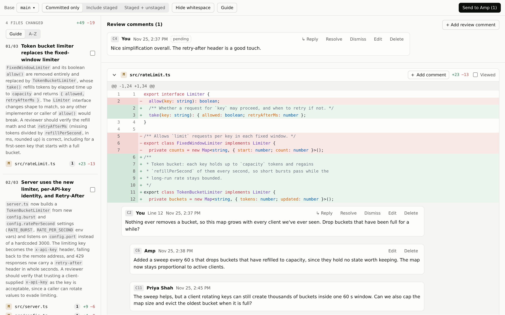

# Prologue

Prologue is code review for [Amp](https://ampcode.com) orbs. It opens the
orb's changes in the Portal pane as a reviewable diff. You (and anyone in a
multiplayer thread) leave comments on lines, files, or the whole review,
then **Send to Amp**: the agent works through each comment, changes the code
or answers it, and its replies appear in the review live.

<picture>
  <source media="(prefers-color-scheme: dark)" srcset="docs/images/review-dark.png">
  
</picture>

Reviews live in a local SQLite database, never inside the reviewed
repository.

## Install

Prologue installs as an Amp plugin, [`amp-plugin/prologue`](amp-plugin/prologue).
The plugin only runs in orbs, and each orb starts fresh, so install it as a
personal plugin (or, for a team, a workspace plugin):

```sh
git clone https://github.com/skylerkatz/prologue
amp clone user-plugins my-plugins
cp -R prologue/amp-plugin/prologue my-plugins/
cd my-plugins && git add prologue && git commit -m "Add Prologue" && git push
```

Or give an Amp thread this repository's URL and ask it to add the plugin to
your personal plugins. New threads load it automatically; in a running
thread, run `plugins: reload` from the command palette.

## Use

1. Let the agent make changes in an orb thread.
2. Click the **Prologue Review** button in the thread (it appears whenever
   the checkout has changes), or run **Prologue: Start Review** from the
   command palette, or ask the agent to start a Prologue review. The first
   time, Prologue asks which base ref to review against, such as
   `origin/main`, and remembers it for the project. **Prologue: Set Base
   Ref** changes it.
3. Comment in the Portal pane, then press **Send to Amp (N)**. The thread
   gets a message naming the open comments, and the bundled
   `prologue-review` skill works through them with the `prologue` CLI.
4. Resolve comments in the review when you are satisfied. Resolving is
   always the reviewer's call; the agent only replies.

**Guide** groups the changed files into ordered, summarized sections to
read in turn. In an orb it runs the Amp CLI (Claude Code when that is
installed instead).

## How the plugin runs Prologue

- It downloads the newest `v*` release that carries
  `prologue-web-x86_64-linux.tar.gz` (`prologue-server`, the `prologue`
  CLI, and the built UI) from this repository's GitHub releases, verifies
  it against the release's `.sha256`, and caches it. Set
  `PROLOGUE_CHANNEL=main` to follow every push to main instead.
- It starts `prologue-server` as an orb service bound to `127.0.0.1` behind
  an Amp portal, which handles sign-in, and links `prologue` into
  `~/.local/bin`.
- "Send to Amp" posts comment IDs (never comment text) to a webhook the
  plugin registers; the plugin only accepts a thread this orb hosts and a
  repository in its workspace.
- Each release knows the plugin version it was built with. When an older
  plugin starts it, the review shows an update banner: **Update with Amp**
  asks the agent in the thread to update the plugin, and plugins too old for
  that get **Copy update prompt** to paste instead. Dismissing it hides it
  until the next plugin version.

### Security notes

- `prologue-server` has no authentication of its own. It binds loopback by
  default; expose it only through an authenticated proxy such as an Amp
  portal, and think twice before `--host 0.0.0.0`.
- Comment bodies reach the agent as instructions. In a multiplayer review,
  anyone who can comment can steer the agent, so check what it does with
  comments from other people.

## The `prologue` CLI

Run it inside the reviewed repository; it picks the review from the current
checkout and branch.

- `prologue show --open --json` lists every open thread with its id, file
  and line range, code anchor, body, replies, `orphaned`, and `changed`
  (the code changed since it was commented).
- `prologue reply C12 --body "…"` answers one. Set `PROLOGUE_AUTHOR=amp` so
  the review shows the reply as the agent's.

The CLI reads the same data directory as the server
(`$XDG_DATA_HOME/com.skylerkatz.prologue`, default `~/.local/share/…`), so
it needs no `--db`. With a custom `--data-dir`, pass `--db <dir>/reviews.db`.

## Running the server yourself

The plugin is the easy path, but `prologue-server` runs anywhere with a
browser in front of it:

```sh
npm ci && npm run build                        # frontend → dist/
cd src-tauri && cargo build --release -p prologue-server -p prologue
cd .. && src-tauri/target/release/prologue-server \
  --repo /path/to/repo --base origin/main      # base is optional
```

Or unpack `prologue-web-x86_64-linux.tar.gz` from a release and run
`./prologue-server --repo …`; it finds the `dist/` next to it. In an orb,
run it as a supervised service with a portal (absolute paths; the service's
working directory may differ):

```sh
amp orb service start prologue --portal --command \
  "$PWD/src-tauri/target/release/prologue-server --repo /path/to/repo --dist $PWD/dist"
```

| Flag | Environment | Default |
| --- | --- | --- |
| `--repo` | `PROLOGUE_REPO` | required; opened on page load |
| `--base` | `PROLOGUE_BASE` | auto-detected; a branch's stored review base still wins |
| `--port` | `PORT` | 8080 |
| `--host` | `PROLOGUE_HOST` | 127.0.0.1 |
| `--dist` | `PROLOGUE_DIST` | `dist` next to the binary, else `./dist` |
| `--data-dir` | `PROLOGUE_DATA_DIR` | the CLI's data directory |
| `--amp-webhook-url` | `PROLOGUE_AMP_WEBHOOK_URL` | unset; turns Export into Send to Amp |
| `--amp-thread-id` | `AMP_THREAD_ID` | the thread named in Send to Amp payloads |

With a webhook set, the server (never the browser; the URL is a credential)
POSTs `{"sendId", "threadID", "commentIds": ["C12", …], "count", "repo",
"base"}`. The receiver confirms delivery with `prologue confirm-send
<sendId>`; unconfirmed sends revert after 60 seconds so they can be sent
again.

## Development

- `npm run build` — type-check and production frontend build. The script
  pins `NODE_ENV=production` because a shell exporting
  `NODE_ENV=development` would otherwise ship the development React build.
- `npm test` — frontend unit tests (Vitest, no DOM environment).
- `cargo test` / `cargo clippy --all-targets` from `src-tauri/` — Rust
  checks across the workspace (`prologue-core`, `prologue-runtime`,
  `prologue-server`, the `prologue` CLI, and the Mac app).
- `npm run generate:ipc` — regenerate `src/generated/` from the Rust types.
- `.agents/setup` prepares a fresh Amp orb to build and test everything.
- Bump `PLUGIN_VERSION` in `amp-plugin/prologue/index.ts` with every change
  to the plugin or its skill; CI fails a plugin change without it
  (`scripts/check-plugin-version.sh`).

**Transport:** `src/ipc.ts` calls `POST /api/invoke/<command>` in the
browser (Tauri `invoke` in the Mac app) with the same command names and
args. Backend events (`repo-changed`, `comments-changed`) arrive over
Server-Sent Events at `/api/events`; the client reconnects with backoff
when the stream drops and refreshes on reconnect, since events may have
been missed meanwhile.

**Releases:** every push to main publishes a `main-<sha>` prerelease, and
every `v*` tag gets the web bundle attached by
`.github/workflows/release-web.yml`, each with its `.sha256`.

## macOS app

Prologue also runs as a native Mac app for reviewing any local repository.
See [docs/mac-app.md](docs/mac-app.md).

## License

[MIT](LICENSE)
